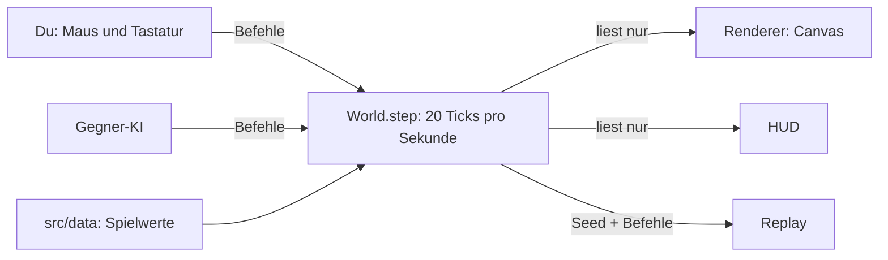

# Terrain-Conquester (Prototyp, Meilenstein 2 in Arbeit)

**Spielen:** <https://paulriegraf-dev.github.io/Terrain-Conquester/> – immer die neueste Version (wird bei jedem Push auf `main` automatisch gebaut).

Echtzeit-Strategie-Runden (Ziel 13–20 Minuten) mit kostenloser automatischer Truppenproduktion (bewusst gedrosselt: wenige, gewichtige Verbände), Einflussgebieten, Nebel des Krieges und veränderbarem Gelände. Gespielt wird gegen eine KI, mit drei Fraktionen: Technoclan, Myriaden und – neu, erste spielbare Fassung – Terra-Former. Gekämpft wird nach Tabletop-Vorbild (Treffen → Verwunden → Rüstung), aber ohne Würfel: Einheiten sind Verbände aus mehreren Modellen. Die Grafik ist bewusst eine einfache Debug-Ansicht: Formen statt Sprites. Das Designdokument steht in [DESIGN.md](DESIGN.md). (Der Projektordner heißt noch `vorposten` – der Arbeitstitel.)

## Starten

**Ohne Installation:** `dist/index.html` per Doppelklick im Browser öffnen. Alles ist eingebettet, nur die Schriften kommen aus dem Internet.

**Zum Weiterentwickeln:**

1. Node.js (LTS) installieren: <https://nodejs.org>
2. Im Projektordner einmal `npm install` ausführen.
3. Mit `npm run dev` startet die Seite auf <http://localhost:8000> und lädt bei jeder Änderung automatisch neu.

| Befehl | Was passiert |
|---|---|
| `npm run dev` | Entwicklungs-Server mit automatischem Neuladen |
| `npm test` | Alle Tests: Determinismus, Replay, Wegfindung, Sicht, Kampf, Energie, Erdwall, Architektur |
| `npm run balance` | Viele Runden KI gegen KI: Rundenlänge und Siegquoten (`npm run balance -- 30` für mehr Runden) |
| `npx tsx scripts/factions.ts 4` | Fraktions-Duell Technoclan gegen Myriaden auf allen Karten (4 Partien pro Karte, Seiten getauscht) |
| `npx tsx scripts/experiment.ts base 8` | Großer Vergleichslauf: alle Karten × alle Fraktions-Paarungen, mit Regel-Varianten (z. B. `shrink` für einen Patt-Auflöser) – Details im Skript |
| `npm run build` | `dist/index.html` neu bauen (eine Datei, läuft offline) |
| `npm run typecheck` | TypeScript prüfen |
| `npm run check` | Alles zusammen: Typen, Tests, Build |

## Steuerung

Unten am Spielfeld sitzt die **Befehlskonsole**: links die Auswahl, in der Mitte die Hinweiszeile, rechts das Befehlsraster. Jeder Knopf zeigt seine Taste, das Raster wechselt mit der Auswahl.

| Eingabe | Wirkung |
|---|---|
| Titelbild | `Enter` oder „Spielen“; „Musik an/aus“; „Startmusik wählen…“ nimmt eine Musikdatei von deinem Rechner (bleibt nur in deinem Browser) |
| Startkarte | Karte (auch asymmetrische), beide Fraktionen, Gegner-Stufe, **deine Seite** (links oder rechts – auf den asymmetrischen Karten ein echter Unterschied) und – zum Ausprobieren – eine **Verlängerung** (Patt-Auflöser ab 20:00, Standard aus) |
| Vorbereitung | Vor dem Start formst du kostenlos Gelände in deiner Kartenhälfte (sie ist dafür aufgedeckt): `1`–`4` Wiese, Wald, Matsch, Schnee, Klick = 3×3-Fläche (9×, Terra-Former 11×). Der Gegner sieht es erst, wenn er hinschaut. `Enter` = Bereit, dann läuft die Runde |
| `1` `2` `3` | Gebäude der eigenen Fraktion wählen (Technoclan: Kaserne, Hangar, Schwerwerk · Myriaden: Myr-Brut, Werkstatt, Schmelze); die Vorschau (2×2) hängt am Mauszeiger – grün mit Kosten, rot mit Grund. Gebaut wird in Bauzonen (hell = Basis, messing gestrichelt = Vorfeld). Klick setzt das Gebäude |
| `W` / `R` | Erdwall setzen / drehen (auch Rechtsklick) – im eigenen Gebiet und bis 6 Kacheln davor |
| `A` | Fronten: pro Route Verteidigen (Ring ums HQ), Halten (Linie an der Grenze, Fernkämpfer dahinter) oder Front (Kolonne, nahe der gegnerischen Basis ausschwärmen) – Tasten `1`–`9` (Zeile = Route); greift nach 10 s. Wer im Angriff die Mitte überquert, bleibt im Angriff |
| `T` | Gelände formen: Untermenü, dann `1`–`4` Bodenart (15 Energie, 3 s – in der eigenen Kartenhälfte 10 Energie, 2 s), `5` Schlucht graben (100 Energie, 6 s, dauerhaft, höchstens 3 eigene gleichzeitig, nur Schweber kommen drüber) oder `6` **Geröll** (wie die Bodenarten: bremst Fußtruppen und vor allem Räder; Myr-Katapulte werfen dort Felsen); jeder Klick formt eine 3×3-Fläche, Ziehen malt Bahnen. Geht im eigenen Gebiet und bis 6 Kacheln davor (auch Niemandsland), nie im gegnerischen. Gegrabene Schluchten schüttet man mit jeder anderen Bodenart wieder zu |
| `C` | Held (HQ-Upgrade) über eine Route `O` `M` `U`. **Myriaden:** Schwarmgeist – Gegner, die in seiner Nähe fallen, füllen Drohnen-Verbände auf (Drohnen altern: 40 s voll, dann Verfall bis 120 s, ab 90 s Todeswut; der Hund bremst das Altern, Forschung „Lebensdauer I/II“ verlängert es). **Technoclan:** Commander – `1` Sammeln (Truppen seiner Route warten bei ihm an der Grenze, auch wenn die Route auf Front steht; der Gegner sieht die Sammelstelle markiert), `2` Losschlagen (alle in seiner Nähe ziehen gemeinsam los, in seinem Tempo); eigene Einheiten in seiner Nähe treffen besser. **Terra-Former:** Landformer – viele eigene Verbände: verschmilzt Gelände, wenige: kopiert eine gerufene Einheit. Fällt ein Held, kehrt er nach 45 s zurück |
| `L` | **Späher:** Spähbericht für 20 Energie – grobe Stärke des Gegners je Route (keine / wenige / einige / viele) und die vorherrschende Panzerung, auch im Nebel; kommt nach 10 s an (Panel rechts) |
| `Q` | **Notfallverlegung** (nur wenn bereit, sonst zeigt der Knopf die Bedrängnis-Uhr): Gegner im eigenen Gebiet nah am HQ doppelt so stark wie deine Truppen dort, 25 s lang → der Rückraum hinter dem HQ öffnet sich (die Karte wird breiter), der bedrängte Bauabschnitt zieht dorthin um, der alte wird Geröll, Gegner dort sind 4 s betäubt, 30 s schnellere Fabriken. Einmal je Flügel |
| Klick auf eigene Fabrik | Befehle (auch per Mausklick im Raster): Einheit wählen `1` `2` `3` (freigeschaltet über Stufen), Stufe `S`, Forschung `R` (Ketten Panzerung/Waffen I–III plus Einzel-Upgrades), Marschbefehl `O` `M` `U` (greift nach 15 s; dieselbe Taste nochmal = sofort für 25 Energie) – laufende Umbauten leuchten orange mit Countdown, Pause `P`, Verkaufen `X` (zweimal), Tarnen `D` (30 Energie; Typ `1`–`3` bzw. `1`–`5`, Route `O` `M` `U`, bestätigen mit Eingabe), **Eilauftrag `B`** (der nächste Verband kommt sofort – 1,5 Energie je Sekunde Restzeit, mindestens 20, danach 60 s Pause für Eilaufträge an allen eigenen Fabriken) |
| Terra-Former | Fünf Fabriken, eine je Bodenart (`1` Wiesenhof, `2` Hain, `3` Schlammgrube, `4` Frosthalle, `5` Steinbruch). Sie bauen zähe Wächter; jeder fünfte Verband (ab Stufe II jeder vierte) ist ein **Terraformer**: Er zieht auf seiner **offensiven Route** Richtung gegnerische Basis (Halten: bis an die Grenze und ins Niemandsland, Front: auch ins gegnerische Gebiet), sucht unterwegs einen 2×2-Block, formt ihn in seinen Boden (je Kachel 4 s, Fortschritt „k/4“ über ihm) und ruft dann die Spezialeinheit seiner Linie (Stufe III: +25 % Leben). Boden, den der Spieler selbst geformt hat (Gelände formen, Vorbereitung), zählt mit: Liegt dort schon ein Block, genügt ein Ritual von 4 s. Jede Kachel trägt je Spieler nur eine Beschwörung – verbrauchte Kacheln sind mit einem leeren Dreieck markiert, unverbrauchter eigener Boden mit einem vollen. Gerufene zählen aufs Einheitenlimit – ist es voll, wartet er („4/4 · Limit“). Forschung an einem Wächter gilt für die ganze Linie, auch für Terraformer und Gerufene. Auf eigenem Boden ihrer Art (im eigenen oder umkämpften Gebiet) haben Wächter und Spezialeinheiten Boni; beim Halten und Verteidigen stellen sie sich von selbst auf eigenen Boden in der Nähe – siehe DESIGN.md |
| Klick auf gegnerische Fabrik | Lagebild: Typ, gebaute Einheit, Marschbefehl und „nächster Verband in x s“ – Fabriken können getarnt sein. Im Nebel bleibt sie gestrichelt mit „vor x s“ und dem geschätzten „nächster ~x s“ |
| Klick auf Außenposten (A) | Bonus und Kontrolle ansehen; `1` `2` `3` baut direkt dort |
| Strategische Orte (S, V) | In der Kartenmitte: **Sensorstation** (Sicht 12 Kacheln) und **Verkehrsknoten** (Marschbefehle greifen nach 8 statt 15 s). Wer allein im Kreis steht, neutralisiert erst und nimmt dann ein; umkämpft passiert nichts, ohne Truppen bleibt alles. Maus darüber zeigt den Stand |
| Markt: „Bestellen“ | Scheinbestellung (40 Energie) – treibt einen Bauteil-Preis 30 s lang hoch |
| Maus über einer Einheit | Verband, **stark gegen / schwach gegen**, Netz-Protokolle (Technoclan), Widerstand, Rüstung, Waffe |
| `Esc` / Rechtsklick | Schrittweise zurück: Werkzeug, Untermenü, Auswahl (Rechtsklick auch auf dem Befehlsraster) |
| `F10` / ☰ Menü | Pausiert die Runde: weiterspielen, neu starten (gleiche oder andere Karte, Fraktionen, Gegner) oder aufgeben |
| `Leertaste` | Spiel pausieren |
| `E` `N` `G` `V` `F` | Ebenen: Einfluss, Nebel, Raster mit Koordinaten, Sichtweiten, Flussfelder pro Truppenart |
| Fabrik-Info | zeigt „stark gegen / schwach gegen“ der Einheit, die gerade gebaut wird; Forschung: Waffen III ist eine **Gabelung** (Spezialist oder Lücke schließen) |

## Aufbau

```
src/
  data/      Spielwerte: Fraktionen, Einheiten (Verbände, Waffenprofile), Gebäude, Gelände, Bewegungsprofile, Regeln, Karten
  sim/       die Simulation – deterministisch, kennt keinen Bildschirm
    world.ts       Spielzustand; step() rechnet genau einen Tick (1/20 s)
    systems/       ein System pro Thema: Produktion, Zielwahl, Bewegung, Formation, Kampf (hitmath.ts), Held, Erdwall …
    placement.ts   Bauen in Bauzonen: wo ein Gebäude stehen darf und was es dort kostet
    flowfield.ts   Wegfindung: Flussfelder pro Bewegungsprofil
    vision.ts      Nebel des Krieges mit Sichtlinien
    commands.ts    die Befehle, über die alles gesteuert wird
  ai/        Gegner-KI – nutzt dieselben Befehle und denselben Nebel wie du
  render/    Debug-Darstellung auf Canvas (wird später durch Pixel-Art ersetzt)
  ui/        HUD, Befehlsraster (commands.ts), Eingabe, Spielschleife, Replay
  match.ts   Partien ohne Bildschirm (Tests, Balance, Replays)
tests/       automatische Tests
scripts/     Build, Dev-Server, Balance-Simulation, Fraktions-Duell, Vergleichsläufe (experiment.ts)
assets/      Musik (wird beim Bauen eingebettet)
```



## Werte und Karten ändern

- **Einheiten, Gebäude, Gelände, Regeln:** Diese Werte stehen in `src/data/*.ts`. Die Dateien sind typisiert, Tippfehler meldet `npm run typecheck`.
- **Bewegungsprofile (Eigenheiten der Truppenarten):** In `src/data/movement.ts` steht pro Bodenart das Tempo; 0 bedeutet unpassierbar.
- **Kampfwerte:** Jede Einheit hat Modelle, Widerstand, Rüstung (und ggf. Ausweichen), jede Waffe Schüsse, Treffsicherheit, Stärke, Durchschlag und Schaden (`src/data/units.ts`); gerechnet wird in `src/sim/systems/hitmath.ts`.
- **Karten:** In `src/data/maps/*.ts` steht meist nur die **linke Hälfte** als Text, die rechte wird automatisch gespiegelt. Asymmetrische Karten (`steilkueste.ts`, `schluchtenland.ts`) geben stattdessen die ganze Breite an (`rows`, `zones`). Zeichen:
  `.` Wiese · `"` Wald · `,` Matsch · `*` Schnee · `:` Geröll · `#` Gebirge · `~` Schlucht · `H` HQ (3×3) · `N` Außenposten (2×2).
  Bauzonen stehen in einer zweiten Textebene `zoneRows` (gleiche Größe, ebenfalls gespiegelt): `.` keine · `B` Basis (befestigt) · `V` Vorfeld · `X` Niemandsland (kein Einfluss, meist ein Streifen in der Mitte). Innerhalb einer Zone setzen Spieler Gebäude frei (Regeln in `src/sim/placement.ts`, Werte in `src/data/rules.ts` unter `building`).
  Karten dürfen verschieden groß sein und eigene Regelwerte mitbringen (`rules`, z. B. größeres Basisgebiet) – siehe `felsenpass-gross.ts`.
  Eine neue Karte trägst du in `src/data/maps/index.ts` ein; die Tests prüfen sie automatisch auf Fairness, Erreichbarkeit und genug Bauraum in jeder Zone. Dort bekommt jede Karte auch ihren **Rückraum** (10 gesperrte Spalten hinter jedem HQ für die Notfallverlegung) und die **strategischen Orte** (Standard: Sensorstation oben, Verkehrsknoten unten, je in der Kartenmitte; eigene mit `sites`).
- Nach Änderungen: `npm test` und `npm run balance`.

## Mit Claude weiterarbeiten

- Gib Claude zu Beginn `DESIGN.md`. Dort stehen auch die Technik-Regeln, etwa dass `src/sim` deterministisch bleiben muss.
- Plane kleine, abgeschlossene Schritte pro Sitzung, z. B. „HQ-Erweiterung Kraftwerk einbauen + Test“.
- `npm run check` muss danach grün sein; der Architektur-Test fängt typische Fehler ab.

## Musik

Musik im Spiel: „8-bit music for game“ (freesound community, Pixabay-Lizenz).
